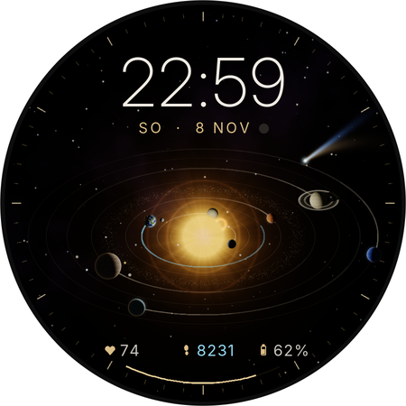
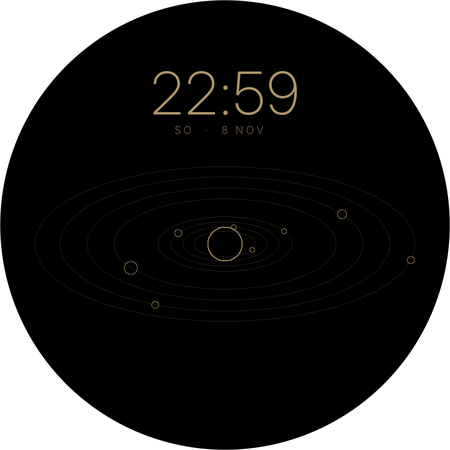
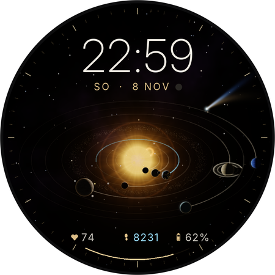

# Sonnensystem – Zifferblatt für die Pixel Watch 5

Watch Face Format (WFF) Version 4, also reines XML ohne Code. Läuft ab Wear OS 6 (API 36).

| Aktiv | Always-On | Echte Positionen |
|---|---|---|
|  |  |  |

## Was drauf ist

Das Aussehen ist 1:1 das freigegebene Referenzbild. Alles Statische wird mit derselben Render-Pipeline vorberechnet (`tools/look.py`) und als ein Hintergrundbild in doppelter Auflösung eingebunden:
- Sternenhimmel mit Nebelband
- Bahnlinien und Asteroidengürtel
- Sonne mit Korona, Protuberanz, Lichtschein und Lichtringen
- Skala und Akku-Spur
- Filmischer Tonemap (ACES)

Live auf der Uhr laufen:
- **Planeten:** Alle 8 bewegen sich in 3D-Schrägansicht (30° über der Bahnebene). Die vorderen sind größer, Merkur und Venus können hinter der Sonne verschwinden. Größen und Abstände sind für das kleine Display hochskaliert, nicht maßstabsgetreu.
- **Vorberechnete Beleuchtung:** 24 Lichtphasen pro Planet. Die zur aktuellen Position passende wird angezeigt. Dadurch stimmen Tag-/Nachtgrenze, Sichelphasen vor der Sonne, die Stadtlichter auf der Nachtseite der Erde und der Ringschatten des Saturn.
- **Monde:** Der Mond kreist um die Erde. Io, Europa, Ganymed und Kallisto kreisen um den Jupiter.
- **Leuchtspuren:** Jeder Planet zieht eine goldene Spur hinter sich her. Die cyanfarbene Spur der Erde zeigt den Schrittfortschritt zum Tagesziel.
- **Anzeigen:** Uhrzeit in wählbarer Schrift, Datum mit echter Mondphase, drei frei belegbare Datenfelder (Standard: Puls, Schritte, Akku) und der Akku als goldener Bogen unten.

Der Komet steht fest an seiner Position und lässt sich abschalten. Für den Always-On-Modus gibt es eine eigene Variante aus Haarlinien: nur Bahnen, Sonnenring, Planeten-Umrisse und die Uhrzeit in Gold.

Um 22:59:30 zeigt der Uhrwerk-Modus genau die Planetenstellung des Referenzbildes.

### Einstellungen (Zifferblatt lange drücken → Anpassen)

| Einstellung | Optionen |
|---|---|
| Planetenbewegung | **Uhrwerk**: Neptun = 24 h, die anderen Planeten nach echten Umlaufverhältnissen heruntergerechnet · **Echte Positionen**: heliozentrische Längen von heute |
| Komet | an / aus |
| Schriftart | Klassisch · Kräftig · Futuristisch · Technisch · Elegant |


### Schriftart und Datenfelder

**Schriftart** (*Anpassen → Schriftart*) für die Uhrzeit, auch im Always-On-Modus. Alle Schriften stehen unter SIL OFL 1.1 und liegen in `res/font`:

| Option | Schrift |
|---|---|
| Klassisch | Inter Display ExtraLight |
| Kräftig | Inter Display SemiBold |
| Futuristisch | Orbitron |
| Technisch | JetBrains Mono Light |
| Elegant | Playfair Display, mit fest eingebauten Versalziffern |

Die Größe wird pro Schrift automatisch so angepasst, dass die Uhrzeit immer gleich breit ist (`time_size()` in `tools/ui_common.py`).

**Datenfelder** (*Anpassen → Feld antippen → Datenquelle*): Das sind Komplikationen, also Felder, die mit jeder Datenquelle auf der Uhr belegt werden können, zum Beispiel Wetter, Termine, Puls, Schritte, Akku, Sonnenaufgang, Weltzeit oder Datenquellen von Apps.

Beim Sonnensystem sind es drei Felder in der Zeile unten:

| Feld | Standard |
|---|---|
| links | Puls |
| Mitte | Schritte |
| rechts | Akku |

Felder liefern Text, Wert und Icon. Mit Wert erscheint der Fortschritt als Zahl. Die Leuchtspur der Erde zeigt weiterhin den Schrittfortschritt, der goldene Bogen unten den Akku.

### Umlaufzeiten im Uhrwerk-Modus

Die Umläufe pro Tag sind auf ganze Zahlen gerundet, damit um Mitternacht nichts springt.

| Planet | Umläufe pro Tag (exakt → genutzt) | Dauer pro Umlauf |
|---|---|---|
| Merkur | 684,6 → 685 | 2 min 6 s |
| Venus | 267,9 → 268 | 5 min 22 s |
| Erde | 164,8 → 165 | 8 min 44 s |
| Mars | 87,6 → 88 | 16 min 22 s |
| Jupiter | 13,9 → 14 | 1 h 43 min |
| Saturn | 5,6 → 6 | 4 h (größte Abweichung, 7 %) |
| Uranus | 1,96 → 2 | 12 h |
| Neptun | 1 | 24 h |

Die Planeten laufen im Uhrzeigersinn, wie im Referenzbild. Im Modus „Echte Positionen“ wird deshalb von unterhalb der Ekliptik geschaut, also gespiegelt.

Berechnet wird die mittlere Länge plus Mittelpunktsgleichung. Das ist auf etwa 1–2° genau. Die Abstände zur Sonne sind nicht maßstabsgetreu.

## Bauen und auf die Uhr bringen

1. Den Ordner in Android Studio öffnen und den Gradle-Sync abwarten. Das Projekt nutzt AGP 9.0 und Gradle 9.2.1 über den Wrapper.
2. Auf der Uhr unter *Einstellungen → Entwickleroptionen* das **WLAN-Debugging** einschalten. In Android Studio dann über *Device Manager → Pair Devices Using Wi-Fi* koppeln.
3. Installieren:
   - **Android Studio:** Die Run-Configuration auf *Launch: Nothing* stellen, weil es keine Activity gibt.
   - **Terminal:** `./gradlew :watchface:installDebug`
4. Aktivieren: auf der Uhr das Zifferblatt lange drücken und *Sonnensystem* wählen. Alternativ per Kommandozeile:
   ```
   adb shell am broadcast -a com.google.android.wearable.app.DEBUG_SURFACE \
     --es operation set-watchface --es watchFaceId com.neon153.sonnensystem
   ```
5. Falls statt des Pulses `-- BPM` erscheint: unter *Einstellungen → Apps → Sonnensystem → Berechtigungen* den Zugriff auf Herzfrequenz bzw. Körpersensoren erlauben.

## Selbst anpassen

`watchface.xml` und alle Grafiken werden erzeugt. Ändere deshalb die Python-Skripte unter `tools/` und nicht die erzeugten Dateien.

```
pip install numpy scipy pillow
python tools/render_assets.py     # Hintergrund, Sonnen-Overlay, Komet, 24 Lichtphasen je Planet, Mondphasen
python tools/gen_watchface.py     # erzeugt watchface/src/main/res/raw/watchface.xml
python tools/simulate.py preview  # Vorschau-Bild aus dem XML rendern
python tools/simulate.py gallery  # aktiv / ambient / echt / ohne Komet + Animation nach build/sim/
```

| Datei | Inhalt |
|---|---|
| `tools/config.py` | Geometrie, Bahnradien, Umläufe und alle WFF-Ausdrücke |
| `tools/look.py` | Das Aussehen des Referenzbildes: Oberflächen, Shading, Sonne, Sterne, Tonemap |
| `tools/render_assets.py` | Rendert alle Bitmaps mit `look.py` |
| `tools/gen_watchface.py` | Baut das XML: Lichtphasen-Bedingungen, Tiefenreihenfolge, Spuren als gestapelte Bögen, beide Modi, Always-On |
| `tools/ui_common.py` | Schriftauswahl und Datenfelder, gemeinsam mit dem Weltraum-Zifferblatt |
| `tools/simulate.py` | Eigener Parser für WFF-Ausdrücke und Renderer, damit sich das XML ohne Uhr prüfen lässt |

Prüfen gegen das offizielle Schema geht mit dem [WFF-Validator](https://github.com/google/watchface):
`java -jar wff-validator.jar 4 watchface/src/main/res/raw/watchface.xml` (das Jar baust du aus `third_party/wff/specification/validator` in diesem Repo)

## Was am echten Gerät noch zu prüfen ist

Das XML besteht den offiziellen WFF-Validator (Version 4), und der Simulator rendert alle Modi. Auf einer echten Uhr lief es aber noch nicht.

- **Akku:** Damit Merkur und Venus flüssig laufen, verwenden die Ausdrücke `[MILLISECOND]`. Dadurch wird im aktiven Modus ständig neu gezeichnet. Wenn der Akku spürbar leidet, in `config.py` bei `lam_expr` für alle Planeten `T_COARSE` nehmen. Die Planeten springen dann sekundenweise.
- **Textposition:** Wie WFF Text vertikal in seiner Box ausrichtet, ist nicht exakt dokumentiert. Wenn Uhrzeit oder Datum ein paar Pixel versetzt sitzen, die `baseline`-Werte in `gen_watchface.py` anpassen.
- **Puls:** Der Herzfrequenzwert kommt vom System und wird nicht live gemessen, sondern in Abständen aktualisiert.

## Lizenzen

- Schriften Inter, Orbitron, JetBrains Mono, Playfair Display: SIL Open Font License 1.1, siehe `licenses/`
- Gradle-Wrapper und Build-Gerüst stammen aus den Wear-OS-Samples (Apache 2.0).
